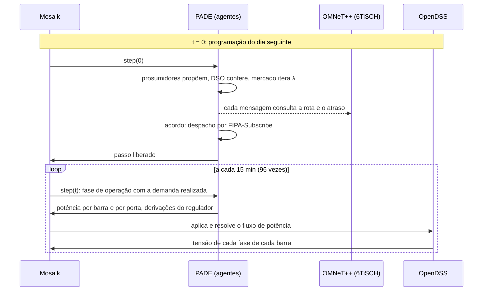

# A plataforma

Quatro simuladores, um por domínio, e um orquestrador de tempo. Nenhum simulador
conhece os outros: o **Mosaik** decide quem executa em que instante e transporta
os dados entre eles.

| Contêiner | Pasta | Domínio |
|---|---|---|
| `pade` | `simulators/pade-opentes` | os agentes do mercado, sobre o framework PADE |
| `grid` | `simulators/grid-opentes` | a rede elétrica, no OpenDSS |
| `mosaik` | `simulators/mosaik-opentes` | o orquestrador e o cenário de mercado |
| `collector` | `simulators/mosaik-opentes` | grava as tensões e potências de cada passo |
| `comm` | `simulators/comm-opentes` | a rede de comunicação 6TiSCH ou Wi-SUN FAN, no OMNeT++ |

A pasta `simulators/market-opentes` não é contêiner: é a biblioteca Python com os
modelos de otimização (Pyomo), a decomposição dual, a liquidação e as figuras.
Os agentes a importam, e ela também roda sozinha, sem agentes, no comando
`./run.sh centralizado`.

## Uma execução

A negociação inteira acontece **dentro** do primeiro passo do Mosaik, com o
relógio da co-simulação parado: o passo fica aberto até o acordo fechar. O tempo
que as mensagens levariam na rede de rádio é medido à parte, pelo servidor
6TiSCH, e não avança o relógio da co-simulação.

O `./run.sh market` roda **duas passadas** sobre a mesma demanda realizada: a
linha de base, em que os prosumidores executam a própria programação sem
mecanismo nenhum, e a negociada. A diferença entre as duas isola o efeito do
mercado.

## Os simuladores

### `pade-opentes`: os agentes

O PADE é o framework de sistemas multiagentes do GREI, em Python, com protocolos
FIPA. A pasta traz a versão 3.0 do framework (`pade/`) e os agentes do mercado
(`agents/market_agents.py`), que vivem num processo só e compartilham uma conexão
com o Mosaik. A camada `agents/network_link.py` intercepta o envio de cada
mensagem e a entrega com o atraso e a perda do modelo de rede escolhido em
`NET_BACKEND`: `ideal`, `lossy` (sorteio) ou `omnet` (6TiSCH ou Wi-SUN FAN).

### `grid-opentes`: a rede elétrica

O OpenDSS, chamado pelo `py-dss-interface`. O `opendss_simulator.py` expõe o
circuito ao Mosaik (cargas, barras, reguladores); o `sensitivity.py` mede as
matrizes de sensibilidade de tensão por perturbação; o `gen_ieee13_market.py`
monta o caso de mercado. O `pv_creator.py` gera as curvas de irradiância e
temperatura dos PV a partir dos dados de estação solar em `data/InfoPV/`.

### `mosaik-opentes`: o orquestrador

O cenário `scenarios/market.py` cria as entidades e as liga: cada barra com
prosumidor, cada porta por fase e cada regulador do OpenDSS a uma entidade dos
agentes, e as tensões de todas as barras ao coletor
(`collectors/elec_collector.py`), que grava o `result_<tag>.csv`.

### `comm-opentes`: a rede de comunicação

O OMNeT++ com o servidor `Tisch.cc`: uma rede LPWA 6TiSCH (IEEE 802.15.4g, 50
kbps, TSCH com salto de canal), com perda de quadro pelo modelo de propagação de
Pister-Hack e roteamento por menor número esperado de transmissões. Ele não
participa do passo do Mosaik: os agentes o consultam por ZMQ a cada mensagem, e
ele responde com o caminho, o atraso e se a mensagem se perdeu. Com
`TISCH_MAC=wisun`, o mesmo rádio funciona como Wi-SUN FAN, com acesso por
disputa e quadros maiores. Os dois modelos estão em
[A rede de comunicação](communication-network.md).

## Pastas fora de `simulators/`

| Pasta | O que tem |
|---|---|
| `docs/` | esta documentação; o `mkdocs.yml` fica na raiz e o site compilado em `site/` |
| `output/` | os resultados das execuções, fora do git |

## Cuidados de operação

Os problemas mais frequentes e como resolvê-los estão em
[Problemas comuns](../how-to-guides/troubleshoot-common-issues.md).

!!! danger "Não sonde as portas dos simuladores `--remote`"

    O `grid` e o `collector` aceitam **uma única** conexão Mosaik e encerram
    depois dela. Um teste de prontidão por TCP consome essa conexão e mata o
    simulador. O `run.sh` detecta a prontidão pelo log e sobe contêineres novos a
    cada passada.

!!! bug "O OpenDSS da imagem não roda com `--user`"

    A engine falha com segfault se o contêiner não for root. O `run.sh` roda
    como root e devolve a posse dos arquivos ao final.
