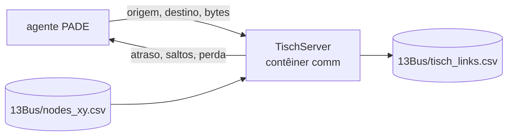

# A rede de comunicação

O contêiner `comm` roda o OMNeT++ com uma rede LPWA entre os agentes: o rádio
IEEE 802.15.4g da tese, com perda de quadro pelo modelo de propagação de
Pister-Hack e roteamento multi-salto. O modelo de rede é o de Melo (2022, seção
6.1.5). Só entra na co-simulação com `NET_BACKEND=omnet`.

## Um servidor de rotas, fora do passo do mosaik

A negociação acontece inteira dentro de um passo de 15 minutos, com o relógio da
co-simulação parado. Por isso o OMNeT++ não participa do passo do mosaik: ele
roda como **servidor de rotas**. A cada mensagem que um agente envia, a camada
de rede dos agentes (`simulators/pade-opentes/agents/network_link.py`) pergunta
por ZMQ, na porta 5556, qual o caminho, o atraso e se a mensagem se perdeu, e
agenda a entrega de acordo.



O tempo que as mensagens levariam na rede é medido à parte e não avança o
relógio da co-simulação. `NET_TIME_SCALE` decide quanto desse atraso vira
espera de relógio real.

As posições dos agentes vêm do caso (`nodes_xy.csv`, gerado com o comprimento
real de cada linha). Como a IEEE 13 não tem topologia de rádio publicada, os
enlaces são os pares com taxa de erro de pacote abaixo de 0,5, e o servidor
grava em `tisch_links.csv` a rede que de fato simulou.

## Dois MACs sobre o mesmo rádio

| `TISCH_MAC` | O que é | Parâmetro principal |
|---|---|---|
| `tsch` (padrão) | 6TiSCH, a rede da tese: cada enlace transmite um quadro de 127 bytes em cada fatia reservada do *slotframe* de 4,04 s | `TISCH_CELLS`, fatias por enlace (padrão 2, calibrado com os tempos da tese) |
| `wisun` | Wi-SUN FAN: mesmo rádio, mesma propagação e mesma regra de enlace, mas acesso por CSMA/CA com salto de canal assíncrono, sem fatia reservada, e quadros de 1.280 bytes | `TISCH_RATE_BPS`: 50 kbps (o rádio da tese), 150 ou 300 kbps |

No Wi-SUN, a sensibilidade piora 10·log₁₀(R / 50 kbps) dB com a taxa, então
taxas maiores têm menos enlaces e mais saltos; a topologia de cada taxa vai para
`tisch_links_wisun_<taxa>k.csv`, sem sobrescrever a da 6TiSCH. O erro de quadro
cresce com o tamanho, PER(L) = 1 − (1 − PER₁₂₇)^(L/127). Os parâmetros do MAC
(recuo do CSMA/CA, reversão, ACK) são os padrões do IEEE 802.15.4 e estão no
`Tisch.ned`.

## De onde vem o tempo da 6TiSCH

Com 2 fatias por enlace num *slotframe* de 4,04 s, um enlace escoa um quadro de
127 bytes a cada 2,02 s, cerca de 63 B/s. Uma mensagem de 24 kB, com 190
quadros, leva 384 s num salto. As mensagens da negociação com λ e programação
por porta têm de 20 a 34 kB, e por isso o ciclo 3 de cada rodada passa dos 300 s
reservados.

No IEEE 13, o concentrador fica no transformador da subestação, na mesma
coordenada do DSO e do agente de mercado, e todo o tráfego dos ciclos 2 e 3
acontece entre esses três. O modelo padrão trata essa troca como rádio. O
parâmetro `colocated_wired` liga por cabo os agentes que dividem a coordenada,
e com ele o ciclo 3 sai da rede ([Resultados](../results.md#de-onde-vem-esse-tempo)).

## Limitações do modelo

Nenhum dos dois MACs tem disputa entre enlaces: cada mensagem é calculada
sozinha. No Wi-SUN a disputa existe de verdade (o concentrador tem um rádio só e
mandaria os 10 despachos em sequência); na 6TiSCH as fatias são reservadas por
enlace, então o modelo é menos otimista ali.

## Os arquivos

```
simulators/comm-opentes/
  Tisch.cc        o servidor: modelo de rádio, enlaces, rotas e atraso salto a salto
  Tisch.ned       os parâmetros do modelo, com o motivo de cada valor
  omnetpp.ini     a configuração usada pelo projeto (seed, escala de tempo, arquivos)
  Dockerfile      OMNeT++ 6 com ZMQ e JSON
```
