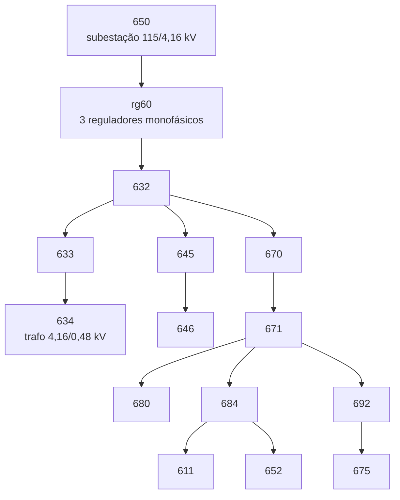

# O caso IEEE 13

O caso de estudo é o *IEEE 13 Node Test Feeder* (Distribution System Analysis
Subcommittee): um alimentador de 4,16 kV, curto, carregado e desequilibrado de
propósito, com barras mono, bi e trifásicas. Ele fica em
`simulators/grid-opentes/src/data/13Bus/` e é **gerado**, e não escrito à mão,
por `gen_ieee13_market.py` (ou `./run.sh caso`), que lê a topologia do circuito
oficial já compilado.

## O circuito oficial confere

Com as derivações do regulador nos valores publicados (10, 8, 11), o circuito do
repositório reproduz o perfil de tensão publicado com erro médio de 0,00044 pu e
máximo de 0,00134 pu, nas 33 medidas de fase da tabela oficial.

## O que o gerador faz

| Elemento | No caso de mercado | Por quê |
|---|---|---|
| cargas | uma carga `Load_<barra>` por barra, nas mesmas fases e ligação da oficial, modelo de potência constante | a interface do mercado escreve uma carga por barra; a restrição do DSO é linearizada com potência constante |
| geração fotovoltaica | cinco PV (15 MW de placa), subtraídos da demanda da barra | o mercado trabalha com demanda líquida |
| armazenamento | portas monofásicas `Port_<barra>_<fase>`, com potência zero | o despacho por fase escreve nelas; com zero, o circuito resolve exatamente igual |
| regulador | ajuste oficial (vreg 122 V, banda 2 V, R 3, X 9), derivações livres no ponto da previsão | ver [O modelo de mercado](market-model.md) |
| perfis | 96 intervalos de 15 min, das curvas de carga do circuito e das curvas de PV | `load_kw.csv`, `pv_kw.csv` |
| preço spot | um dia de mercado day-ahead do Nordpool | `spot_price.csv`, dado de entrada |
| cenários | nove dias sintéticos (fator e deslocamento sorteados, semente fixa) | `scenario_pool.npz`, para o modelo estocástico do prosumidor e a demanda realizada |
| rádio | posições dos agentes com a direção do desenho e o comprimento real de cada linha | `nodes_xy.csv`, para a rede 6TiSCH |

A faixa de tensão do mercado é **0,97 a 1,03 pu**, mais estreita que a ANSI C84.1
Range A (0,95 a 1,05 pu) do alimentador; ela aperta a restrição de sobretensão,
que é o fenômeno que se quer precificar. As barras `650` e `rg60` ficam fora da
restrição do DSO: são terminais internos da subestação, e nenhuma injeção do
mercado as move (sensibilidade de 0,05 µpu/kW, três ordens abaixo de uma barra
de carga).

## Os agentes

Dez prosumidores (as barras com carga ou geração: 611, 632, 634, 645, 646, 652,
670, 671, 675 e 692), um concentrador, que é a cabeceira do alimentador porque há
um único transformador de distribuição, o DSO e o agente de mercado. A restrição
de carregamento da Eq. 6.28 passa a limitar o alimentador inteiro, em 4.500 kW.

## O armazenamento

O alimentador tem 3.390 kW de pico de carga e 4.030 kW de pico de geração, com o
PV1 sozinho pondo 5 MW de placa numa derivação bifásica cuja carga é 230 kW. O
armazenamento foi dimensionado contra a geração: para cada intervalo, a menor
injeção total que mantém todas as barras dentro da faixa somou 4.226 kW e 6,3 MWh.
A alocação é de 1,27 vez isso:

| Tipo | Barras e potência |
|---|---|
| de rede (despachado pelo DSO) | 646: 800 kW, 645: 550, 634: 550, 652: 500 |
| de prosumidor | 671: 500, 675: 500, 670: 450, 611: 300, 632: 300, 646: 200, 634: 200, 692: 200, 645: 150, 652: 150 |

Capacidade de 3,3 kWh por kW, estado de carga entre 10% e 90%. O
dimensionamento foi feito com a tensão média por barra, e a análise por fase o
confirmou factível para o caso como está montado.

## As decisões medidas

O caso foi montado a partir de medições sobre o próprio circuito, e não de regra
de bolso. Os scripts que as produziram respondiam a uma pergunta cada um e
saíram do repositório depois que a resposta foi incorporada ao gerador e ao
mercado; estão na tag `antes-da-limpeza`, em `estudos/ieee13/`.

=== "O regulador"

    Três configurações ao longo do dia: derivações travadas nos valores
    publicados deixam 51,4% das leituras fora da ANSI Range A, porque são uma
    fotografia do pico de carga; travadas pela inicialização, 11,0%; com o ajuste
    oficial e derivações livres, 3,7%. O caso usa o **ajuste oficial**, e o
    mercado fixa as derivações pelo ponto da previsão (ver
    [O modelo de mercado](market-model.md)).

=== "O armazenamento"

    Para cada um dos 96 intervalos, a menor injeção total que mantém todas as
    barras dentro da faixa, pela matriz de sensibilidade do caso, soma
    **4.226 kW e 6,3 MWh**, concentrada nas barras onde o fotovoltaico excede a
    carga local. A alocação adotada é **5.350 kW em 14 bancos**, e zera a
    violação do dia, o que um limite uniforme por barra só faz a partir de
    600 kW:

    | limite por barra | folga residual |
    |---|---|
    | 200 kW | 15,00 mpu |
    | 400 kW | 6,12 mpu |
    | **600 kW** | **0, factível** |

=== "O reativo da demanda"

    A convenção do mercado é `kvar = kW · tan(acos 0,9)` sobre a demanda
    **líquida**. Quando a barra exporta, isso faz o PV injetar reativo, o que um
    inversor com fator de potência unitário não faz. No pior intervalo, 22 dos
    49 mpu de excesso de tensão da barra 652 vêm dessa convenção.

## As portas por fase

| Barra | Fases da carga | Portas |
|---|---|---|
| 611 | C | 611.C |
| 632 | A, B, C | 632.A, 632.B, 632.C |
| 634 | A, B, C | 634.A, 634.B, 634.C |
| 645 | B | 645.B |
| 646 | B, C (triângulo) | 646.B, 646.C |
| 652 | A | 652.A |
| 670 | A, B, C | 670.A, 670.B, 670.C |
| 671 | A, B, C (triângulo) | 671.A, 671.B, 671.C |
| 675 | A, B, C | 675.A, 675.B, 675.C |
| 692 | C, A (triângulo) | 692.A, 692.C |

São 22 portas. As do armazenamento de rede são as das barras 634, 645, 646 e 652.
Mesmo onde a carga é em triângulo, a porta é fase-neutro: é como se liga um
inversor de quatro fios.

## O que a representação atual simplifica

A conversão tem uma carga por barra, equilibrada entre as fases dela. Três
consequências, todas medidas:

1. Em 634, 670 e 675 o desequilíbrio **entre fases** da carga oficial se perde
   (a 675, por exemplo, tem 485, 68 e 290 kW nas fases A, B e C, e cada uma com
   curva diária própria).
2. O PV4 está fisicamente na fase C da barra 645 e entra na fase B, que é a da
   carga daquela barra.
3. O PV1 (5 MW) é fisicamente estrela nas fases B e C e entra no triângulo B-C da
   carga da 646.

Com as cargas e os PV nas fases físicas, o caso base passa de 287 para 677 pontos
(barra-fase-intervalo) acima de 1,03 pu, e de 0 para 602 abaixo de 0,97 pu, no
mesmo dia: a fase B chega a 1,12 pu enquanto a A cai a 0,92. Nessa representação,
o armazenamento atual não basta para nenhuma formulação; só a por fase com
inversor de quatro fios fica factível, e com 1,88 vez o armazenamento. Uma
formulação por barra, ou com inversor equilibrado, não fecha em tamanho nenhum,
porque nenhuma injeção igual nas três fases sobe a fase A e baixa a B ao mesmo
tempo.

Reconstruir o caso com as fases físicas é o próximo passo natural, e exige
redimensionar o armazenamento.
