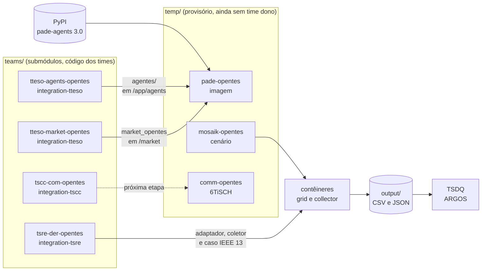

# Organização dos repositórios

O `co-simulation-opentes` é o repositório que **integra** o trabalho dos times do
OpenTES. Ele não guarda cópia do código de nenhum time: cada um entra por um
**submódulo git** na pasta `teams/`, que aponta para o repositório do próprio
time. O que fica aqui é a integração (o `run.sh`, o console, o compose e esta
documentação) e, em `temp/`, o que ainda não tem time dono: as imagens Docker, o
cenário do Mosaik, o coletor, o caso IEEE 13 de mercado e a rede 6TiSCH. A pasta
`teams/` faz o papel da antiga `simulators/`; `temp/` é provisória e se esvazia
à medida que cada time absorve a sua parte.



## Os submódulos

Cada submódulo segue a branch `integration-<time>` do repositório do time, que é
a branch reservada para o que vai para a co-simulação. O campo `branch` do
`.gitmodules` registra isso.

| Pasta | Repositório | Branch | O que a co-simulação usa | Onde entra |
|---|---|---|---|---|
| `teams/tsre-der-opentes` | [grei-ufc/tsre-der-opentes](https://github.com/grei-ufc/tsre-der-opentes) | `integration-tsre` | o adaptador do OpenDSS, o coletor, o caso IEEE 13 de mercado (`data/13Bus/`) e as ferramentas que o geram | contêineres `grid` e `collector`, em `/app`; o caso também em `comm` e `pade`, em `/grid-data` |
| `teams/tteso-market-opentes` | [grei-ufc/tteso-market-opentes](https://github.com/grei-ufc/tteso-market-opentes) | `integration-tteso` | a biblioteca `market_opentes`: modelos de otimização, decomposição dual, operação, liquidação e figuras | contêineres `pade` e `mosaik` (figuras), em `/market` |
| `teams/tteso-agents-opentes` | [grei-ufc/tteso-agents-opentes](https://github.com/grei-ufc/tteso-agents-opentes) | `integration-tteso` | os agentes do mercado (`agentes/market_agents.py`) e a camada de rede (`agentes/network_link.py`) | contêiner `pade`, em `/app/agents` |
| `teams/tscc-com-opentes` | [grei-ufc/tscc-com-opentes](https://github.com/grei-ufc/tscc-com-opentes) | `integration-tscc` | ainda nada: a rede do caso é a 6TiSCH de `comm-opentes`, e a integração do TSCC é a próxima etapa | nenhum contêiner por enquanto |

Enquanto a branch `integration-<time>` não existe no repositório do time, o
submódulo fica fixado no commit do `main` dele que está registrado aqui. Nada
muda sozinho: o commit em uso é sempre o que o `co-simulation-opentes` registra.

Duas peças ficam de fora dos submódulos:

- **O PADE** é instalado na imagem `opentes/pade` como o pacote publicado
  `pade-agents==3.0` ([grei-ufc/pade](https://github.com/grei-ufc/pade)), a
  mesma versão que o `tteso-agents-opentes` declara.
- **O TSDQ** não roda na co-simulação: a ARGOS
  ([tsdq-dataview-opentes](https://github.com/grei-ufc/tsdq-dataview-opentes))
  lê os resultados depois. Por isso os arquivos de `output/` devem seguir o
  formato que ela aceita: CSV com a primeira coluna de tempo e as colunas
  nomeadas `<simulador>.<entidade>-<atributo>` (por exemplo
  `DSS-0.Bus-611-V3_pu`), e uma topologia JSON vinculada ao CSV pelo hash
  SHA-256 (campo `results_sha256`). Os detalhes estão em
  [docs/entrada_topologia.md](https://github.com/grei-ufc/tsdq-dataview-opentes/blob/main/docs/entrada_topologia.md)
  do TSDQ. Hoje o `result_<tag>.csv` já segue a convenção de nomes das
  tensões e grava `NaN` na fase que a barra não tem, porque `0.0` é medição
  válida para a ARGOS; a topologia vinculada ainda não é exportada pelo `run.sh`.

## O que é do `co-simulation-opentes`

| Pasta | O que tem |
|---|---|
| `run.sh`, `cli/` | o comando `opentes` e o console |
| `docker-compose.yaml` | os cinco serviços e os volumes que montam o código de `teams/` e de `temp/` |
| `.gitmodules`, `teams/` | os submódulos dos times |
| `pyproject.toml`, `uv.lock` | o ambiente Python local, para a IDE e a documentação |
| `docs/`, `mkdocs.yml` | esta documentação |

## A pasta `temp/`

Guarda, como referência, o que foi desenvolvido no `co-simulation-opentes`
antes dos submódulos. As mudanças são feitas em `teams/`, e cada item deixa de
ser usado quando o time o absorve na branch `integration-<time>`; a meta é apagar
a pasta no fim do projeto. O destino é uma proposta, a confirmar com cada time.

| Pasta | O que tem | Destino proposto |
|---|---|---|
| `temp/grid-opentes/` | cópia de referência: a co-simulação já não a usa | absorvida por `teams/tsre-der-opentes` |
| `temp/pade-opentes/` | a imagem dos agentes (PADE, Pyomo, OpenDSS) | TTESO (`tteso-agents-opentes`) |
| `temp/mosaik-opentes/` | a imagem do Mosaik e o cenário `scenarios/market.py`; o coletor antigo ficou só como referência | cenário para o TTESO ou o TSCC |
| `temp/comm-opentes/` | a rede 6TiSCH e Wi-SUN FAN no OMNeT++ (`Tisch.cc`) | TSCC (`tscc-com-opentes`) |

O motivo de cada destino está em `temp/README.md`.

## Regras de trabalho

1. **As mudanças de cada time ficam em `teams/`**, na branch
   `integration-<time>` do submódulo, que guarda só o que o caso do OpenTES usa.
   O restante do repositório do time continua no `main` dele.
2. **`temp/` é referência.** Ela não recebe mudanças: cada item é levado para o
   submódulo do time, e a co-simulação passa a usar a versão de lá.
3. **Toda atualização de submódulo é conferida** contra os resultados de
   referência antes de ser registrada (ver
   [Conferir uma mudança](../contributing/development-setup.md#conferir-uma-mudanca)).

## Clonar e atualizar

```bash
git clone --recurse-submodules https://github.com/grei-ufc/co-simulation-opentes
# num clone que já existe, sem os submódulos:
git submodule update --init
```

O `opentes submodulos` mostra, para cada submódulo, a branch que ele segue, se
ela já existe no repositório do time e qual commit está em uso:

```bash
opentes submodulos             # o estado
opentes submodulos atualizar   # cada um vai para a ponta da sua integration-<time>
opentes market                 # confere o resultado
git add teams/ && git commit   # registra os commits novos
```

O `atualizar` só move os submódulos cuja branch `integration-<time>` já existe;
os outros ficam no commit fixado. O `run.sh` recusa rodar se algum submódulo
estiver vazio, com a instrução para baixá-lo.

O código de `teams/` é montado por volume nos contêineres: atualizar um
submódulo vale na próxima execução, sem reconstruir imagem.
