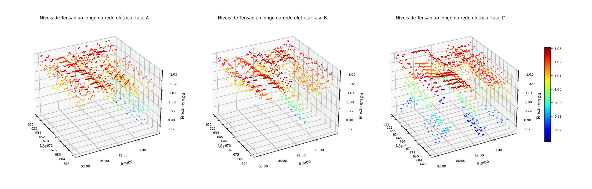
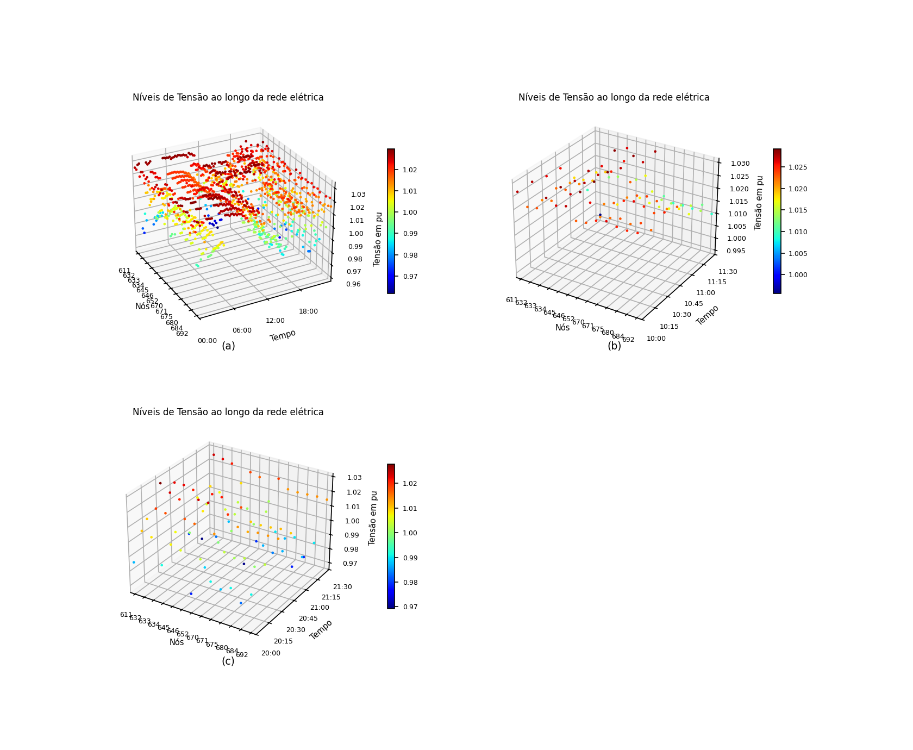
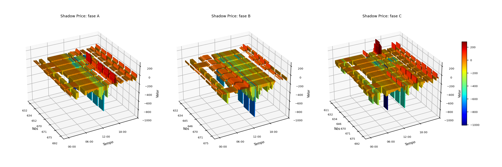

# Resultados

Todos os números desta página são do caso IEEE 13 como o repositório o gera, com
o regulador nas derivações da previsão, a rede ideal entre os agentes e um
cenário por prosumidor. Para refazê-los:

```bash
./run.sh centralizado && ./run.sh market && ./run.sh figuras                       # por fase
MARKET_FASE=0 ./run.sh centralizado && MARKET_FASE=0 ./run.sh market && MARKET_FASE=0 ./run.sh figuras   # por barra
```

As contagens são de leituras barra-fase-intervalo nas 32 fases de carga e de
passagem do alimentador (a subestação fica de fora), ao longo dos 96 intervalos
do dia. A faixa do mercado é 0,97 a 1,03 pu; a ANSI C84.1 Range A, 0,95 a
1,05 pu, conta também as fases da subestação.

## A co-simulação

A passada **base** executa a programação que os prosumidores propõem, sem
negociação. A **negociada** executa a programação acordada e, a cada 15 min, a
fase de operação sobre a demanda realizada. Em ambas, quem resolve a rede é o
OpenDSS, e não o modelo linear.

| Formulação | Passada | > 1,03 pu | < 0,97 pu | fora da ANSI A | rodadas |
|---|---|---:|---:|---:|---:|
| por barra (`MARKET_FASE=0`) | base | 472 | 65 | 95 | |
| | negociada | **134** | 18 | 3 | 48 |
| por fase (padrão) | base | 522 | 96 | 105 | |
| | negociada | **9** | 28 | **0** | 42 |

A formulação por barra cumpre o que promete: na **média** das fases, a negociada
tem zero leituras acima de 1,03 pu. Só que a média esconde 134 leituras de fase
acima do limite, concentradas na fase B (646, 645, 634, 675, 671) e na fase A da
634, ao longo do dia todo. Por fase, o excesso cai para 9 leituras, nenhuma
acima de 1,031 pu, e nenhuma leitura sai da ANSI A.

A subtensão residual cresce de 18 para 28 leituras, quase todas na fase C do
fim do ramal 684-611 (611, 684), à noite e no começo da manhã. A menor tensão é
0,961 pu, dentro da ANSI A. É o lado que a formulação por fase passa a ver e que
a por barra, vigiando a média, deixava de fora.

As linhas de base das duas formulações não são iguais porque a proposta do
prosumidor é aplicada de outro jeito: por barra, como carga equilibrada na
barra; por fase, dividida igualmente entre as portas.

=== "Por fase"

    

    Tensão de cada fase de cada barra ao longo do dia, na fase de operação da
    formulação por fase.

=== "Por barra"

    

    O mesmo gráfico na formulação por barra, que mostra a média das fases: (a) o
    dia, (b) e (c) as janelas de maior sobretensão e de maior subtensão. Nada
    passa de 1,03 pu, mas as fases individuais passam.

## O preço sombra por fase

Com a análise por fase, o λ deixa de ser uma superfície barra × tempo e passa a
ser três, uma por fase, cada uma só com as barras que têm aquela fase.



Os vales mais fundos, de −700 a −1.000, aparecem ao meio-dia, nas barras onde o
fotovoltaico mais excede a carga: é onde o DSO precisa que o armazenamento
absorva. O λ está na unidade de `Ck` vezes potência, e não em moeda (ver
[O modelo de mercado](explanation/market-model.md)).

## A negociação centralizada

A mesma decomposição dual sem agentes nem Mosaik, sobre a previsão. O fluxo não
linear é conferido com as derivações do regulador fixadas pela previsão:

| Formulação | > 1,03 pu | < 0,97 pu | fora da ANSI A | rodadas | energia deslocada |
|---|---:|---:|---:|---:|---:|
| por barra | 151 | 18 | 1 | 48 | 6.903 kWh |
| por fase, inversor de quatro fios | 9 | 28 | 0 | 42 | 7.527 kWh |
| por fase, inversor de três fios | 5 | 26 | 0 | 63 | 8.987 kWh |

Corrigir por fase custa 9% mais energia deslocada que corrigir a média, e
converge em menos rodadas. Com o inversor de três fios
(`MARKET_DISPOSITIVO=equilibrado`), o excesso cai um pouco mais, mas exige 19% mais energia que
o de quatro fios para o mesmo efeito, porque uma injeção igual nas três fases
mexe também nas fases que já estavam dentro da faixa. Na co-simulação, o de três
fios fica em 11 leituras acima e 26 abaixo, sem sair da ANSI A, e leva 63
rodadas contra 42.

As rodadas são as do critério de parada relativo (`MARKET_EPS_REL = 1e-3`, ver
[O modelo de mercado](explanation/market-model.md)). Com o critério absoluto da tese, eram 81, 66
e 108, para as mesmas contagens de tensão.

## Sobre a rede 6TiSCH

Com `NET_BACKEND=omnet NET_TIME_SCALE=0.02`, as mensagens atravessam a rede
6TiSCH do OMNeT++. O resultado elétrico é o mesmo da rede ideal: 42 rodadas, 9
leituras acima de 1,03 pu, 28 abaixo de 0,97 e nenhuma fora da ANSI A. Nenhuma
das 2.978 mensagens se perdeu, e não houve retransmissão. O despacho da
programação acordada, por FIPA-Subscribe, faz parte do tráfego: o DSO publica ao
concentrador, que publica aos 10 prosumidores, e as confirmações sobem.

O custo aparece no tempo. As mensagens do DSO, do concentrador e do agente de
mercado com λ e programação por porta têm de 20 a 34 kB, e o ciclo 3 de cada
rodada gastou de 474 a 541 s de rede, acima do orçamento de 300 s em **todas** as
42 rodadas. Somadas, são 5,8 h de rede para fechar a negociação do dia seguinte;
com o critério de parada absoluto, que pedia 66 rodadas, eram 9,1 h.
Na fase de operação, com uma rodada por janela, o ciclo fica em 22 s.

### De onde vem esse tempo

O atraso é o que o escalonamento TSCH prevê: com 2 *cells* por enlace num
*slotframe* de 4,04 s, um enlace escoa um quadro de 127 bytes a cada 2,02 s
(cerca de 63 B/s), e uma mensagem de 24 kB, com 190 quadros, leva 384 s num
salto, a mediana medida. O backend `lossy` transmite a 50 kbps contínuos, cem
vezes mais, e por isso não serve de comparação direta.

Dois experimentos (por fase, quatro fios, 22/10/2026) separam o que é do rádio e
o que é do caso; nos dois o resultado elétrico é idêntico ao da rede ideal:

| Variação | Ciclo 3 por rodada | Co-simulação |
|---|---|---|
| 6TiSCH, padrão | 474 a 541 s | ~18 min |
| agentes na mesma coordenada por cabo (`TISCH_ARGS=--**.tisch.colocated_wired=true`) | 0 s | 105 s |
| tamanhos declarados da referência (`NET_MESSAGE_SIZE=declarado`) | 18 a 26 s | 262 s |

No IEEE 13 o concentrador fica no transformador da subestação, na mesma
coordenada do DSO e do agente de mercado, e todo o tráfego dos ciclos 2 e 3
acontece entre esses três. O padrão continua tratando essa troca como rádio. A
mensagem mais lenta que sobra no rádio é o despacho: o concentrador manda a cada
prosumidor a programação inteira (24 kB, até 779 s), embora ele use só as suas
portas.

Com o backend `lossy` a 1% e 5% de perda (e `MARKET_ROUND_TIMEOUT=3`), a
negociação fecha nas mesmas 42 rodadas, com 3 e 18 retransmissões, e o resultado
elétrico é idêntico ao da rede ideal. Esse teste achou uma falha, já corrigida: a
primeira troca da verificação de operação (AM para AD) não era retransmitida, e
com 5% de perda 8 das 95 janelas ficavam sem correção.

### Comparação de redes: 6TiSCH com mais fatias e Wi-SUN FAN

Mesmo cenário (por fase, quatro fios, 22/10/2026), mesmo rádio da tese (IEEE
802.15.4g a 0 dBm, mesmo modelo de propagação e mesma regra de enlace). Em todas
as linhas a negociação fecha em 42 rodadas, sem perda nem retransmissão, e o
resultado elétrico é idêntico ao da rede ideal, tensão a tensão.

| Rede (`TISCH_MAC`, parâmetro) | Ciclo 3 por rodada | Rodadas acima de 300 s | Rede somada na negociação | Despacho, maior atraso | Ciclo 3 na operação | Co-simulação |
|---|---|---|---|---|---|---|
| 6TiSCH, 1 fatia | 945 a 1.081 s | 42 | 11,6 h | 1.550 s | 44 s | 33 min |
| 6TiSCH, 2 fatias (padrão) | 474 a 541 s | 42 | 5,8 h | 779 s | 24 s | 17 min |
| 6TiSCH, 5 fatias | 192 a 218 s | 0 | 2,3 h | 316 s | 12 s | 8 min |
| 6TiSCH, 10 fatias | 97 a 110 s | 0 | 1,2 h | 161 s | 8 s | 5 min |
| 6TiSCH, 20 fatias | 50 a 56 s | 0 | 0,6 h | 84 s | 6 s | 3 min |
| Wi-SUN FAN, 50 kbps | 5 a 6 s | 0 | 4 min | 8 s | 0,4 s | 1,2 min |
| Wi-SUN FAN, 150 kbps | 2 s | 0 | 1 min | 4,5 s | 0,2 s | 1 min |
| Wi-SUN FAN, 300 kbps | não fecha | | | | | |

- Na 6TiSCH o tempo cai na proporção das fatias, como a conta prevê. O ciclo 3
  cabe no orçamento a partir de 4 ou 5 fatias por enlace.
- O Wi-SUN a 50 kbps, com o mesmo rádio da tese, fica duas ordens de grandeza
  abaixo: transmite quando quer, sem esperar fatia, e em quadros de 1.280 bytes.
- A 300 kbps a sensibilidade cai 7,8 dB, a rede fica com 51 enlaces (contra 74),
  e a ligação da subestação ao resto do alimentador passa a depender de enlaces
  com erro de 0,81 por quadro de 1.280 bytes. Mensagens de 24 kB não atravessam,
  o concentrador esgota as retentativas e prosumidores entram com programação
  zero. Mais taxa só ajuda enquanto o alcance continua cobrindo o alimentador.
- Os dois modelos não têm disputa pelo meio. No Wi-SUN ela existe de verdade (o
  concentrador tem um rádio só e mandaria os 10 despachos em sequência, uns 80 s
  no total); na 6TiSCH as fatias são reservadas por enlace, então o modelo é
  menos otimista ali.

## Onde ficam os arquivos

Cada execução grava em `output/market/` (por fase) ou `output/market_por_no/`
(por barra). A lista do que cada arquivo contém está em
[Arquivos de saída](reference/output-files.md), e as figuras em `figuras/`,
dentro da mesma pasta.
