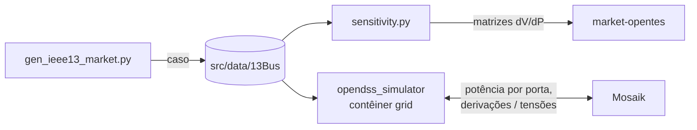

# grid-opentes: a rede elétrica

O OpenDSS, chamado pelo `py-dss-interface`, com o caso IEEE 13 barras do
mercado. Resolve o fluxo de potência de cada passo da co-simulação e mede as
matrizes de sensibilidade que o operador da rede usa na negociação.

## O papel no projeto



- **Antes da co-simulação:** `gen_ieee13_market.py` monta o caso a partir do
  circuito oficial, e `sensitivity.py` mede, por perturbação no próprio OpenDSS,
  quanto a tensão de cada barra (ou fase) muda com 1 kW injetado em cada ponto.
  O `market-opentes` usa essas matrizes na restrição de tensão do DSO.
- **Durante a co-simulação:** o contêiner `grid` expõe o circuito ao Mosaik.
  A cada 15 minutos recebe a potência de cada carga e porta de armazenamento e
  as derivações do regulador, resolve o fluxo e devolve as tensões.

## O que há aqui

```
src/simulators/
  opendss_simulator.py   entrada do contêiner (--remote 0.0.0.0:5671)
  api_opendss.py         o circuito exposto ao Mosaik: cargas, barras, linhas, reguladores
  opendss_wrapper.py     a interface com o OpenDSS por trás da API
  gen_ieee13_market.py   monta o caso de mercado (./run.sh caso)
  sensitivity.py         matrizes de sensibilidade de tensão, por barra e por fase
  pv_creator.py          curvas de irradiância e temperatura dos cinco PV
  pv_validator.py        conferências das curvas e da ligação dos PV
src/data/
  13Bus/                 o caso: circuito, perfis, alocação, posições de rádio, matrizes
  InfoPV/                estações solares (BR-PVGen) que alimentam o pv_creator
Dockerfile, requirements.txt   a imagem opentes/grid
pyproject.toml                 o mesmo pacote, para uso local com `uv`
```

Os arquivos de `13Bus/` que **não** são gerados: o circuito oficial
(`IEEE13Nodeckt*.dss`, `IEEELineCodes.dss`, `LoadShape.dss`), as curvas de PV
(`ieee13_*_5min.*`, saídas do `pv_creator`) e o preço spot (`spot_price.csv`).
O resto sai do `gen_ieee13_market.py` e do `sensitivity.py`.

## Rodar

Dentro do projeto, pelo `run.sh` da raiz: `./run.sh market` sobe este contêiner,
e `./run.sh caso` regenera o caso e as matrizes. Isolado, pela imagem:

```bash
docker compose build grid
# o caso, a partir do circuito oficial e das curvas de PV
docker compose run --rm --no-deps grid python src/simulators/gen_ieee13_market.py
# a matriz por fase (sem --por-fase, a por barra)
docker compose run --rm --no-deps -e GRID_DIR=/app/src/data/13Bus grid \
  python src/simulators/sensitivity.py day --por-fase \
  --load-csv /app/src/data/13Bus/load_kw.csv --pv-csv /app/src/data/13Bus/pv_kw.csv \
  --out /app/src/data/13Bus/sensitivity_fase.npz
# as curvas de PV, se as estações mudarem
docker compose run --rm --no-deps grid python src/simulators/pv_creator.py
```

O simulador `--remote` aceita **uma única** conexão Mosaik e encerra depois
dela: não sonde a porta com TCP. O OpenDSS da imagem só carrega rodando como
root no contêiner.

## Autoria

O simulador Mosaik do OpenDSS (`api_opendss.py`, `opendss_wrapper.py`) e o
gerador de curvas de PV são da equipe TSRE do OpenTES; o `pv_creator.py` foi
adaptado do `tsre-der-opentes`. O caso de mercado e as matrizes de
sensibilidade são do time TTESO. Mais sobre o caso em
[docs/explanation/ieee13-case.md](../../docs/explanation/ieee13-case.md).
