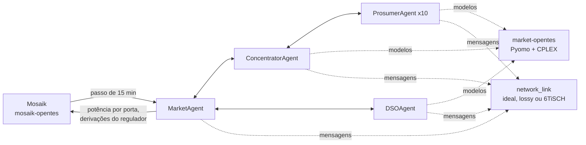

# pade-opentes: os agentes do mercado

O sistema multiagente do OpenTES: prosumidores, concentrador, operador da rede
(DSO) e agente de mercado, que negociam a programação do armazenamento por
troca de mensagens FIPA-ACL. Roda sobre o **PADE** (Python Agent DEvelopment
framework), que vem junto nesta pasta.

## O que há aqui

```
agents/
  market_agents.py   os agentes do mercado e a ponte com o Mosaik (ponto de entrada da imagem)
  network_link.py    a camada de rede opcional entre os agentes: ideal, com perda, ou 6TiSCH (OMNeT++)
pade/                o framework PADE 3.0: núcleo, protocolos FIPA, driver Mosaik e CLI
pade/tests/          exemplos de uso do PADE, independentes do mercado (tabela abaixo)
Dockerfile           imagem opentes/pade: PADE + Pyomo + OpenDSS, com os agentes
pyproject.toml       pacote do PADE (`pade-agents`), para uso local com `uv`
```

## O papel no projeto

Os agentes não resolvem os modelos de otimização por conta própria: importam a
biblioteca [`market-opentes`](../market-opentes/), montada no contêiner em
`/market`, que tem a formulação e chama o CPLEX. O que fica aqui é a
**negociação**: quem fala com quem, em que ordem, com que conteúdo, e o que fazer
quando uma mensagem não chega.



Um único simulador Mosaik (`MarketMosaikSim`) vive no processo dos agentes. A
cada passo, ele entrega ao Mosaik a potência de cada porta do armazenamento e as
derivações do regulador, que o `grid-opentes` aplica no OpenDSS. A formulação e
a sequência da negociação estão em
[docs/explanation/market-model.md](../../docs/explanation/market-model.md).

## Rodar

Dentro do projeto, pelo `run.sh` da raiz (`./run.sh market`), que sobe este
contêiner junto dos outros. As variáveis que ele lê estão no
`docker-compose.yaml`, no serviço `pade`.

Isolado, a imagem também serve para usar o PADE sem o mercado:

```bash
docker compose build pade
docker run --rm -w /opt/pade/pade/tests/agent_example_4 opentes/pade:local \
  pade start-runtime --username pade_user --password 12345 --port 24000 agent_example_4_updated.py
```

O `start-runtime` sobe o AMS (porta 8000), o Sniffer (8001) e o script dos
agentes, e grava a sessão em `logs/` (`sessions.csv`, `agents.csv`,
`messages.csv`, `events.csv`). Usuário e senha vão na linha de comando para que
o CLI não pare esperando digitação.

## Exemplos do PADE

Cada pasta de `pade/tests/` é um exemplo independente. Rode de dentro da pasta,
com `pade start-runtime --port 24000 <arquivo>`.

| Pasta | Arquivo | O que demonstra |
|---|---|---|
| `hello_world` | `hello_world_minimal.py`, `hello_world.py` | o menor agente possível; a segunda versão troca uma mensagem ACL real |
| `script_5` | `script_5_updated.py` | a menor troca de mensagens entre dois agentes |
| `test_pingpong` | `test_pingpong.py` | PING e PONG, pelo runtime ou em dois terminais |
| `test_agent` | `test_agent_updated.py` | troca simples entre dois agentes de teste |
| `agent_example_1` | `agent_example_1_updated.py` | três agentes trocando mensagens em anel |
| `agent_example_2` | `agent_example_2_updated.py` | comportamento temporal; a variante `_with_messages` gera tráfego ACL |
| `agent_example_3` | `agent_example_3_updated.py` | FIPA Request entre um agente de relógio e um de tempo |
| `script_3` | `script_3_updated.py` | FIPA Request mínimo: REQUEST, AGREE, INFORM |
| `agent_example_4` | `agent_example_4_updated.py` | FIPA Contract Net com dois participantes |
| `script_2` | `script_2_updated.py` | Contract Net entre um consumidor e três livrarias |
| `script_4` | `script_4_updated.py` | Contract Net numa recomposição de energia |
| `agent_example_5` | `agent_example_5_updated.py` | FIPA Subscribe: um publicador, dois assinantes |
| `agent_example_6` | `agent_example_6_updated.py` | Subscribe com dois publicadores e quatro assinantes |
| `power_systems` | `agent_example_power_system_1_updated.py` | agentes supervisionando um fluxo de potência trifásico na IEEE 13 (ver o `README.md` da pasta) |
| `mosaik_example` | `agent_example_1_mosaik_updated.py` + `first.py` | co-simulação PADE + Mosaik, o padrão que o `MarketMosaikSim` segue |
| `iec_61850` | `agent_example_iec_61850_1_updated.py` | agentes conversando com um IED IEC 61850; exige `pyiec61850` |

Os três protocolos FIPA dos exemplos 3 a 6 são os mesmos que o mercado usa:
Contract Net para as rodadas da negociação, Request para o solver e Subscribe
para o despacho.

## Sobre o PADE

O PADE foi desenvolvido no GREI, na Universidade Federal do Ceará, e é mantido em
[grei-ufc/pade](https://github.com/grei-ufc/pade), onde estão a documentação
completa e o histórico da migração para Python 3.12. A cópia desta pasta é a
versão 3.0, sem alterações para o OpenTES. Licença MIT, em [LICENSE](LICENSE).
Para citar:

> Melo, L. S., Sampaio, R. F., Leão, R. P. S., Barroso, G. C., Bezerra, J. R.
> Python-based multi-agent platform for application on power grids. *Int Trans
> Electr Energ Syst.* 2019; 29:e12012. https://doi.org/10.1002/2050-7038.12012
